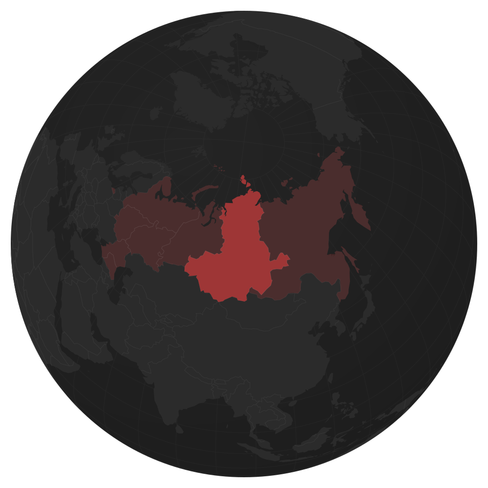

# globe-svg

Renders an orthographic globe with highlighted regions into a static SVG at build time. Made for
coverage maps, dealer networks and office locations.

[](https://www.npmjs.com/package/globe-svg)
[](https://github.com/eeegoloauq/globe-svg/actions/workflows/ci.yml)
[](LICENSE)



- One cacheable SVG, no JavaScript on the page
- Countries or states merged into named groups
- Optional JSON overlay for hover and click
- Natural Earth data, pinned for reproducible output

## Install

```sh
npm install --save-dev globe-svg
```

Needs Node.js 20 or later.

## Usage

```sh
npx globe-svg --config globe.config.json
```

```json
{
  "center": [10, 45],
  "regions": {
    "source": "ne-admin0-50m",
    "key": "ADM0_A3",
    "groups": [{ "id": "dach", "codes": ["DEU", "AUT", "CHE"] }]
  }
}
```

This writes `globe.svg` and, when regions are set, `globe-regions.json` next to the config.

| Key | |
|---|---|
| `center` | `[longitude, latitude]` at the center of the globe |
| `regions` | Region source, code property and groups to highlight |
| `colors` | Ocean, land, borders, grid and rim colors |
| `detail` | Share of points kept; raise it for large prints |
| `output` | Output directory and file names |

From JavaScript:

```js
import { generate } from 'globe-svg'
const { svg, layer, warnings } = await generate(config)
```

[Reference: all options, overlay, data](docs/reference.md) · [Design](docs/design.md) · [Roadmap](ROADMAP.md)

## Development

`npm ci`, `npm test`, `npm run examples` to rebuild the example globes.

## License

[MIT](LICENSE). Natural Earth data is public domain.
